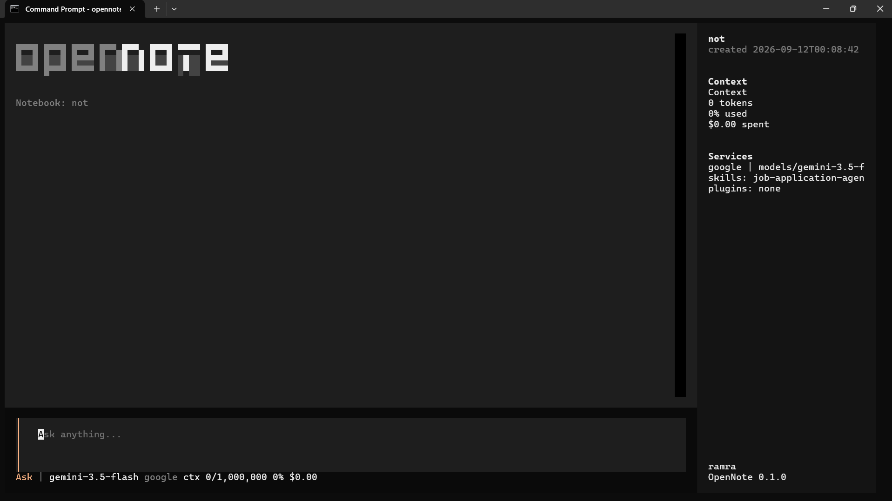

<div align="center">

  <h1 align="center">OpenNote</h1>

  <p align="center">
    An open source, privacy-focused agentic harness to help you study
     <br />
     Follow <a href="https://x.com/zirmythen">@zirmythen on X</a> for updates
    <br />
    <a href="docs/0-START-HERE/index.md">📚 Get Started</a>
    ·
    <a href="docs/3-USER-GUIDE/index.md">📖 User Guide</a>
    ·
    <a href="docs/2-CORE-CONCEPTS/index.md">✨ Features</a>
    ·
    <a href="docs/1-INSTALLATION/index.md">🚀 Deploy</a>
  </p>
</div>

---

## Quick start

```bash
pip install -e ".[dev]"

opennote create my_notebook
opennote ingest paper.pdf --notebook my_notebook
opennote ask "What does the paper claim about retrieval?" --notebook my_notebook
opennote chat --notebook my_notebook
```

---
## A private, multi-model, 100% local, full-featured alternative to NotebookLM 



In a world dominated by Artificial Intelligence, having the ability to think and acquire new knowledge , is a skill that should not be a privilege for a few, nor restricted to a single provider.

**OpenNote empowers you to:**
- **Control your data** - Keep your research private and secure
- **Choose your AI models** - Support for 5+ providers including OpenAI, Anthropic, Ollama, LM Studio, and more
- **Organize multi-modal content** - PDFs, videos, audio, web pages, and more
- **Search intelligently** - Full-text and vector search across all your content
- **Chat with context** - AI conversations powered by your research
---


## Features

| Category | What you get |
|----------|-------------|
| **Ingestion** | PDF (Docling + fallback), DOCX, HTML/URL, TXT/MD — with heading/paragraph locators and section-heading citations |
| **Retrieval** | Vector search (SentenceTransformer + ChromaDB) + BM25 hybrid; always available, no API key required |
| **BYOK Chat** | Anthropic, OpenAI, OpenCode, Cerebras, Groq, Google — keys in OS keychain or env; live model validation via `GET /models` |
| **Grounded Q&A** | Single-turn `ask` with citation validation; multi-turn `chat` where the model decides when to search |
| **Studio generators** | Mind‑map, study guide, FAQ, briefing, timeline, suggested questions — with audio and narrated video output |
| **TTS chain** | groq → openai → gemini → edge-tts; graceful degradation to markdown transcript |
| **Narrated video** | Per‑slide Pillow images + TTS mp3 + ffmpeg mux to MP4; degrades to script + slides if any stage fails |
| **Textual TUI** | Tab cycles `ask → search → studio → tutor → socratic → curriculum` (built-in education agents, global); `/studio` submenu; slash commands `/mindmap /study /faq /briefing /timeline /suggest /audio /video /open` · `/use <skill>` · `/skills /skill /plugins /agents /agent /capabilities /context /theme /help` + `/snake` waiting-room game |

---
## Open Notebook vs Google Notebook LM

| Feature | Open Notebook | Google Notebook LM | Advantage |
|---------|---------------|--------------------|-----------|
| **Privacy & Control** | Self-hosted, your data | Google cloud only | Complete data sovereignty |
| **AI Provider Choice** | 5+ providers (OpenAI, Anthropic, Groq, Cerebras.) | Google models only | Flexibility and cost optimization |
| **Content Transformations** | Custom and built-in | Limited options | Unlimited processing power |
| **Deployment** | Your own terminal | Google hosted only | Deploy anywhere |
| **Citations** | Basic references (will improve) | Comprehensive with sources | Research integrity |
| **Customization** | Open source, fully customizable | Closed system | Unlimited extensibility |
| **Cost** | Pay only for AI usage | Free tier + Monthly subscription | Transparent and controllable |

---

##  Installation

**One-line (global):**

```bash
# macOS / Linux / Git Bash / WSL
curl -fsSL https://raw.githubusercontent.com/natarmr/OpenNote/main/install | bash

# Windows PowerShell 5.1 — bare `curl` is an alias for Invoke-WebRequest, use:
curl.exe -fsSL https://raw.githubusercontent.com/natarmr/OpenNote/main/install | bash
# or native PowerShell:
iwr -useb https://raw.githubusercontent.com/natarmr/OpenNote/main/install.ps1 | iex
```

**Via npm or bun (Python 3.10+ still required):**

```bash
npx @natarmar/opennote --help                  # try it without installing
npm install -g @natarmar/opennote              # then: opennote --help
bunx @natarmar/opennote --help                 # bun works too
```

The npm package is a thin launcher: on first run it installs the Python app into a
versioned cache and then runs it. See [`npm/README.md`](npm/README.md) for the cache
and Python-selection options.

**Via pipx (Python-native one-liner):**

```bash
pipx install "opennote @ https://github.com/natarmr/OpenNote/archive/refs/heads/main.tar.gz"
```

*Warning:* never run bare `pip install opennote` or `npm install -g opennote` — those
names belong to unrelated projects on PyPI and npm. The official npm name is the scoped
`@natarmar/opennote`; the Python installers fetch the GitHub tarball instead.
---
##  Usage

### Notebook management

```bash
opennote create <name> [--model BAAI/bge-small-en-v1.5]
opennote list
opennote rename <old> <new>
opennote delete <name>
```

### Ingest sources

```bash
opennote ingest [path-or-url] --notebook <name> [--parser auto|docling|fallback] [--ocr] [--force]
```

### Vector search (LLM‑free, cited)

```bash
opennote search "<query>" --notebook <name> --top-k 3 [--source file.pdf]
```

### BYOK keys

```bash
opennote auth add anthropic        # prompts for key, validates live, auto-picks a model
opennote auth list                 # providers, key source (keychain/env), selected models
opennote auth models openai        # live chat models; --set <id> to change default
opennote auth verify               # re-validate stored keys
opennote auth remove groq
```

### Local GGUF (offline, no API key)

```bash
# 1. Install optional local backend (llama-cpp-python; CPU wheels for 3.10-3.12, 3.13 needs newer wheel)
py -m pip install -e ".[local]"          # or: pip install llama-cpp-python

# 2. Register a model file (GGUF)
opennote local add D:\models\qwen2.5-7b-q4.gguf my-qwen --n-ctx 4096
opennote local list                       # shows registered models, * = active
opennote local use my-qwen                # set active

# 3. Chat via local model (no network)
opennote chat --provider local            # or: opennote ask "..." --provider local
# TUI: /model local  or palette → Switch Provider → local

# How it works
# - opennote/chat/local.py:LocalLlamaClient implements LLMClient via llama_cpp.Llama
# - Module cache _llama_cache keyed by (path, n_ctx, threads) → one load per process
# - History trimmed via trim_messages to n_ctx*3 chars; tool calls use JSON {"tool":..}
# - Env: LLAMA_N_GPU_LAYERS (0), LLAMA_CHAT_FORMAT (default) tune GPU/offload
```

Keys stored in the OS keychain when available, else read from `ANTHROPIC_API_KEY`, `OPENAI_API_KEY`, `OPENCODE_API_KEY`, `CEREBRAS_API_KEY`, `GROQ_API_KEY`, `GEMINI_API_KEY`. Validation requires network; `--no-verify` stores without checking.

##  Capabilities (runtime‑probed, advertised to the model)

- **Tavily web search** requires `TAVILY_API_KEY`; otherwise degrades gracefully
- **TTS** resolves groq → openai → gemini → edge-tts; falls back to markdown transcript
- **Video** requires TTS + ffmpeg on PATH; each stage degrades independently
- **Retrieval** is always available (local embeddings + ChromaDB)

---
##  Configuration (`opennote.json`)

All non-secret settings live in one layered JSON/JSONC file. Keys stay in the OS
keychain (see `opennote auth`); `auth.json` keeps only provider→model mappings.

```jsonc
// ~/.opennote/opennote.json           (global)
// <project>/opennote.json             (project)
// <project>/.opennote/opennote.json   (project-local, highest precedence)
{
  "model": "groq/qwen/qwen3.8-27b",  // optional default for new work
  "last_used": {                      // auto-updated on /model, /connect, --provider
    "provider": "groq",
    "model": "qwen/qwen3.8-27b"
  },
  "default_agent": "ask",
  // Minimal custom OpenAI-compatible provider (key from keychain or env):
  "providers": {
    "my-gateway": {
      "name": "My Gateway",
      "base_url": "https://llm.example.com/v1",
      "env": "MY_GATEWAY_KEY",
      "models": ["my-model-1", "my-model-2"]
    }
  },
  "theme": "tokyonight",             // opencode|opencode-light|tokyonight|catppuccin|gruvbox
  "keybinds": { "leader": "ctrl+x" },
  "retrieval": { "top_k": null, "bm25": true, "bm25_alpha": 0.5, "context_budget": 12000 },
  "permissions": [
    { "action": "script", "resource": "*", "effect": "ask" },
    { "action": "plugin", "resource": "*", "effect": "deny" },
    { "action": "webfetch", "resource": "*.internal", "effect": "deny" }
  ]
}
```

Permissions are ordered; the **last matching rule wins**. Effects are `allow`,
`deny` and `ask`. `ask` opens an approval prompt in the TUI (`1` once · `2`
always · `3`/`esc` reject) or in the chat REPL; "always" persists a project rule.
Agents may narrow permissions further in their frontmatter `permission:` block.

Run `opennote config` to see the resolved config, `opennote config --path` for
loaded files, or `opennote config --effective` for a table of every provider's
key source, model and endpoint plus the resolved default. `{env:VAR}` is
substituted anywhere in the config.

### Default model and last-used

Startup picks a provider/model in this order: explicit `--provider`/`--model`
> notebook session > global `last_used` > configured default > most recently
> validated provider. It is **never alphabetical** anymore. Switching model in
a session does not rewrite your configured default (like opencode); it updates
`last_used` globally so the next launch opens where you left off. To change the
configured default explicitly, edit `model:` in `opennote.json`.

### Adding a provider

`opennote auth add <provider>` prompts for a key (hidden), validates it and
auto-selects a model. Use `--env VAR` to read the key from an environment
variable instead of prompting. Keys go to the OS keychain; non-secrets to
`auth.json`. Env fallback works without adding: set `GROQ_API_KEY`,
`GEMINI_API_KEY`, `OPENAI_API_KEY`, `MODEL_API_KEY` (Meta), etc. — the effective
source is shown in `opennote auth list` and `opennote config --effective`.

---

## Roadmap (future)

- Images (OCR) support
- Non‑terminal UI surfaces
- More parser backends
- Plugin‑based studio generators

---

##  License

MIT — see `LICENSE` for details.
